# YES, CAPTAIN!

A LAN-party **bridge simulator for loud friends**, in a hand-inked 1930s cartoon style.

> The captain sees everything and touches nothing.
> Everyone else touches one thing and sees almost nothing.
> The only way to fly is to talk. Constantly.

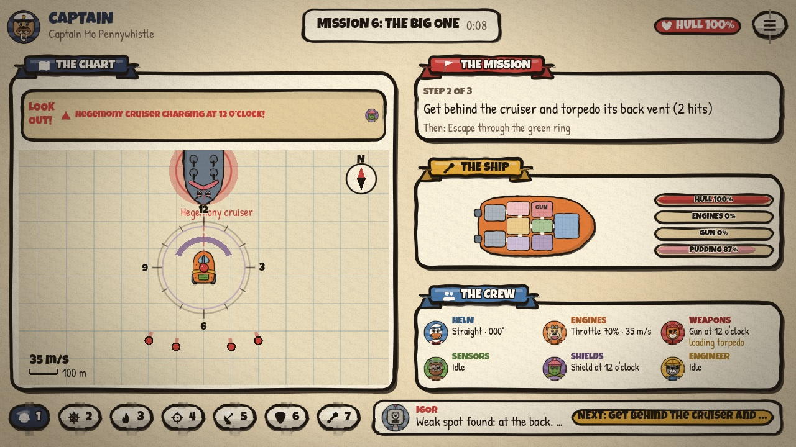

You're the crew of a garbage hauler from the Free Lanes. On bin day you collect a skip and find **Pudding**
inside: the beloved pet of the Hegemony's Overlord. Now the whole Hegemony fleet wants Pudding back, the ship's
robot **IGOR** thinks you are all idiots, and the ship keeps breaking.

Built with **Godot 4** (developed on 4.7, GDScript only, Compatibility renderer). Laptops, LAN first.

---

## The idea

Inspired by *Artemis* and *Empty Epsilon*, with *Overcooked*-style panic and a dash of *Cosmoteer*. The fun
lives in the gap between two kinds of knowledge:

- **The Captain** has the big picture and no controls at all. They see:
  - a chart of everything around the ship;
  - the mission goal;
  - a board of every ship system;
  - a live line on what each crew member is doing;
  - **forecasts** like *"Reactor overload in 5s"* or *"Cruiser charging at 12 o'clock!"*, each showing whose face
    to shout at.
- **The crew** each see one thing in depth. Helm only has a compass. Weapons only sees down the gun barrel.
  Engines can't see where the ship is going. The host only sends each seat what that seat is allowed to know.

The captain says *"Shield to 3 o'clock! Engines, ease off, the reactor's about to blow!"* and the crew make it
happen.

## Easy to pick up, deeper every mission

In mission 1 each crew member gets **one control**. Each later mission adds **one** new thing. IGOR's briefing
introduces it, and the screen marks whose station it lives on. Nothing appears before it's been taught.

| # | Mission | New today |
|---|---|---|
| 1 | Driving Lesson | The basics: steer, throttle, scan, shoot, shield, repair |
| 2 | Bin Day | **Tractor beam**, and the discovery of Pudding |
| 3 | Running Hot | **Heat**: full throttle and non-stop firing overheat things, and things catch **fire** |
| 4 | Pet Sitting | **Pudding's mood**: upset Pudding escapes and chews the ship |
| 5 | Customs | **The comms dial**: only Sensors can hear the officer's demands |
| 6 | The Big One | **Torpedoes and weak spots**: scan twice, get behind the cruiser, fire |
| 7 | Hot Pursuit | **Boost and barrel roll**: outrun a patrol you can't shoot |
| 8 | Brownout | **Power and overload**: the reactor can't run everything at full |
| 9 | Grabbers | **Grabber drones**: shake them off, shield them off or shoot them off |
| 10 | Run to Haven | Everything at once |

Missions unlock in order and remember your best stars. A mission earns up to 3 stars: one for finishing, one for
keeping the hull above 60%, and one for beating par time.

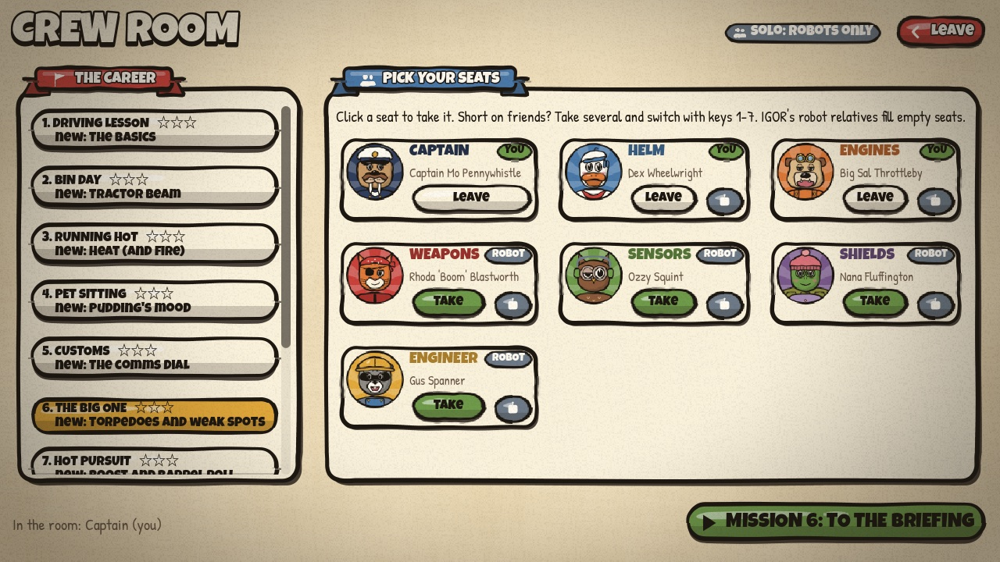

## The seats

| Seat | Persona | Hero control | Unlocks later |
|---|---|---|---|
| **Captain** | Captain Mo Pennywhistle (walrus) | None. Voice only. | |
| **Helm** | Dex Wheelwright (duck) | Ship's wheel (stays where you leave it) | Barrel roll |
| **Engines** | Big Sal Throttleby (bulldog) | Brass throttle (stays where you leave it) | Heat, boost |
| **Weapons** | Rhoda "Boom" Blastworth (cat) | Turret dial + FIRE, viewed through a periscope | Gun heat, torpedoes |
| **Sensors** | Ozzy Squint (owl) | Radar: click a blip, hold SCAN | Comms dial, weak-spot scans |
| **Shields** | Nana Fluffington (turtle) | Shield dial, marked like a clock | Tractor beam, Pudding care |
| **Engineer** | Gus Spanner (raccoon) | Ship cutaway: click a room, hold REPAIR | Power bars and overload |

One player can hold several seats and switch between them with keys **1-7**. IGOR's robot relatives fill any
empty seat, so you can play solo, as a pair, or with a full crew of seven. A robot crew can finish every mission.

| | |
|---|---|
| 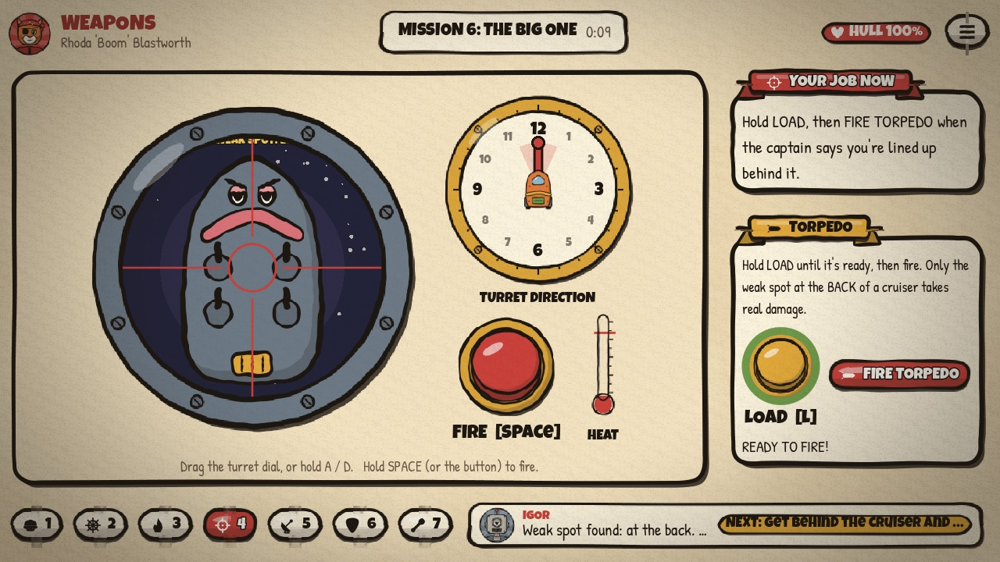 | 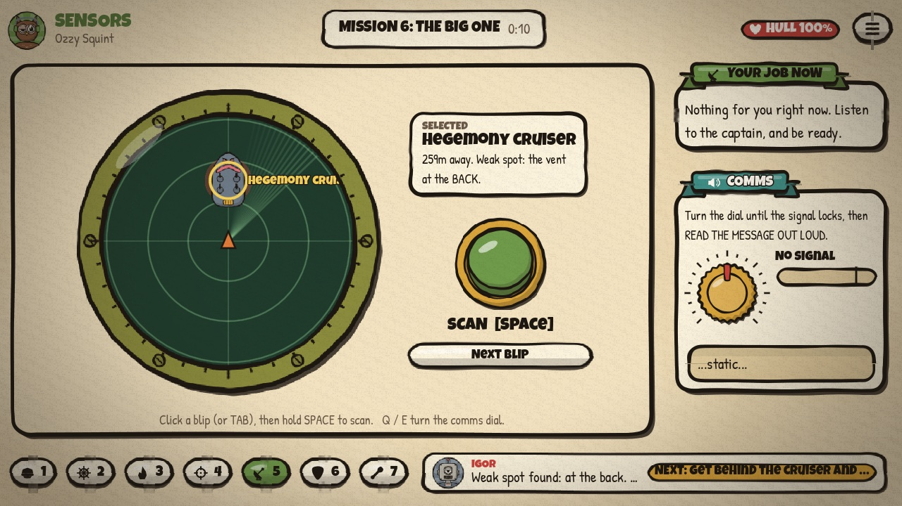 |
| 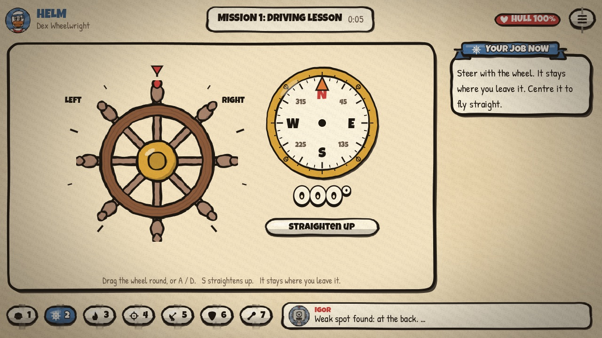 | 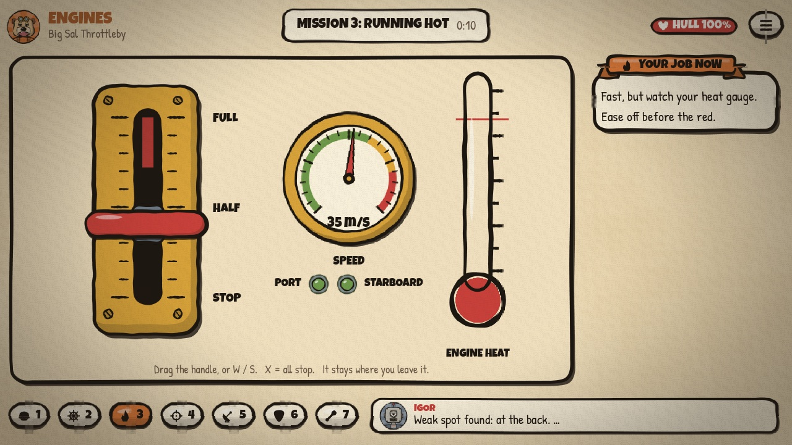 |
| 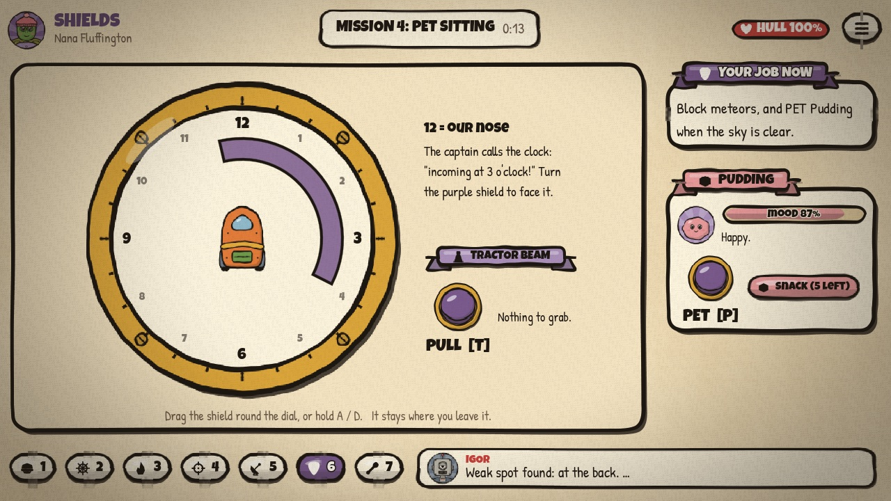 | 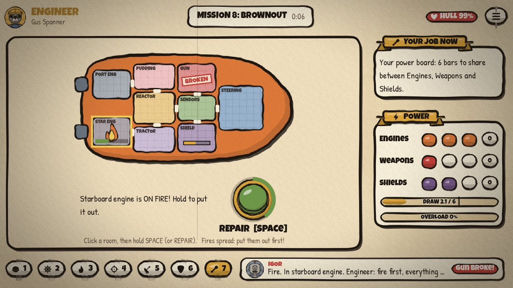 |

## How a session goes

1. **Title screen:** play with a robot crew, host a LAN game, or join one.
2. **Crew Room:** pick a mission from the career, then take your seats.
3. **IGOR's briefing**, read aloud and subtitled, in three pages: what's going on, the plan (numbered steps) and
   **new today**. Everyone presses *I'M READY*, then a 3-second countdown starts the mission.
4. **The mission:** the captain's screen tracks the current step; each crew screen has a *Your job now* hint.
5. **Debrief:** stars, crew awards (*Duct Tape Hero*, *The Wall*, *Pudding Whisperer*, *IGOR's Disappointment*...),
   then the next mission or another try.

| | |
|---|---|
| 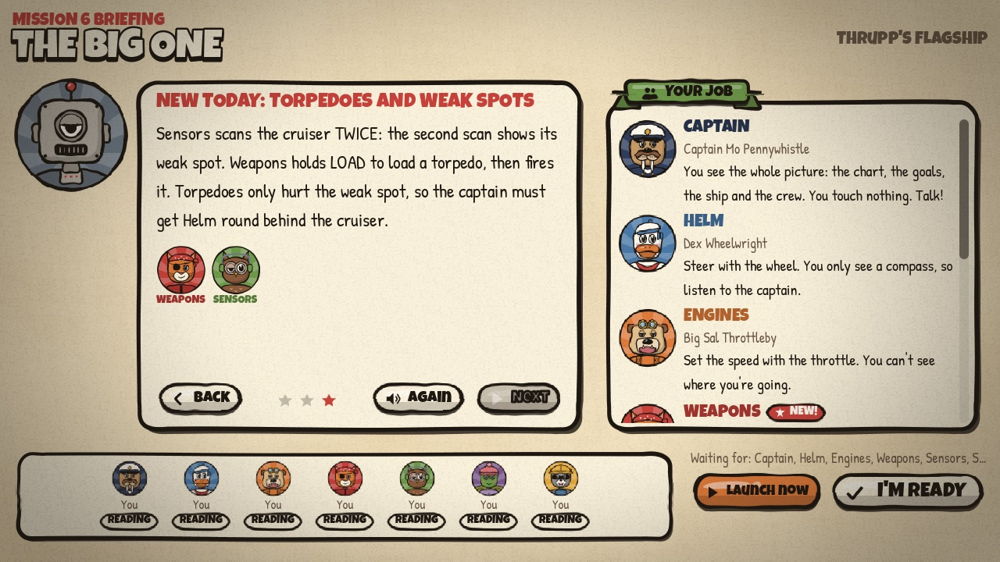 | 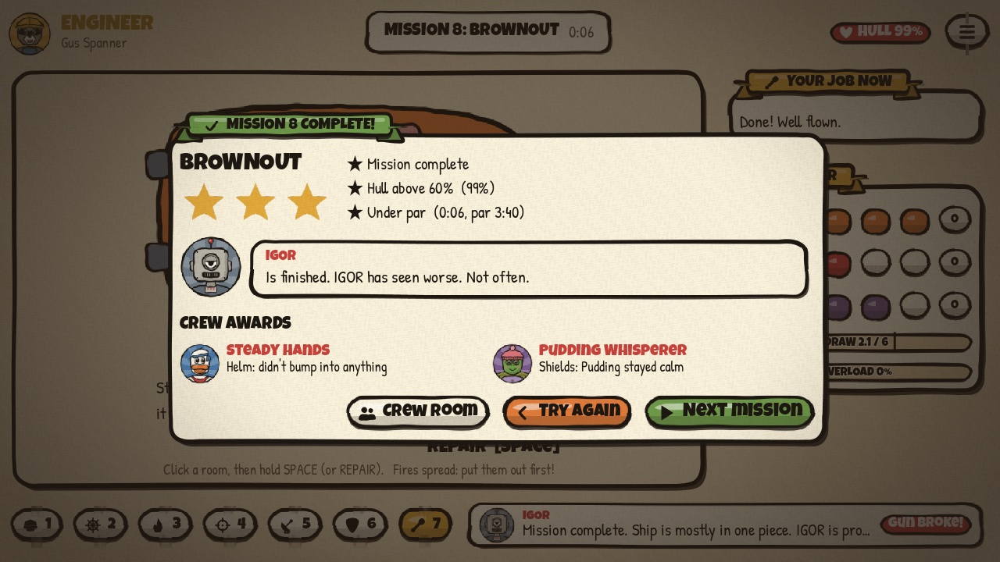 |

## Core features

- **Information asymmetry, enforced by the server.** Each seat gets a filtered snapshot: the helm's data contains
  no map, no contacts and no goals, and a test checks this.
- **Forecasts for the captain:** incoming fire and which side it's coming from, enemies charging up, overload and
  overheat countdowns, fires, broken systems, stuck grabbers, Pudding on the loose.
- **Everything breaks, everything is fixable.** Hits damage the system on the side that was hit. Fires spread
  until the Engineer puts them out. If one engine is down, the other one pulls the ship round.
- **Sticky controls.** The wheel, throttle and dials stay where you leave them, so you can let go and shout.
- **IGOR**, the deadpan third-person ship robot from the Foundry. He narrates and mocks the crew, and he's voiced
  with the OS text-to-speech (you can turn it off).
- **Hand-inked art, no 3D.** Rubber-hose cartoon animals, wobbly brush outlines, cream paper, film grain. All of
  it is generated as SVG by `tools/make_art.py` and drawn crisply by the engine at any resolution.
- **Laptop-friendly layouts**, checked automatically from 1024×768 up to 1920×1080.

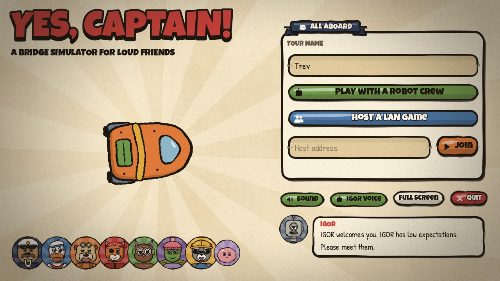

## Run it

```bash
godot --path .
```

Or open the folder in the Godot editor and press Play.

| Title screen button | What it does |
|---|---|
| **Play with a robot crew** | You start as captain; robots run every other station. Take more seats in the Crew Room. |
| **Host a LAN game** | Friends join over the LAN. The Crew Room shows your address (port 7777). |
| **Join** | Type the host's address and pick seats in the Crew Room. |

For a dedicated host with no player (e.g. on a TV box):

```bash
godot --headless --path . -- --server --port=7777
```

The first player to join becomes the host and starts the missions.

**Networking:** WebSocket over TCP port 7777 (open it in your firewall). It works across the internet with a
port-forward or a VPN such as Tailscale. There's no built-in voice chat: shouting across the room is the game.

### Keys

| Seat | Keys |
|---|---|
| Any | **1-7** switch seat, **Esc** menu |
| Helm | **A / D** turn the wheel, **S** straighten up, **R** barrel roll |
| Engines | **W / S** throttle, **X** all stop, **B** boost |
| Weapons | **A / D** turn the turret, **Space** fire, **L** load torpedo, **T** fire torpedo |
| Sensors | **Tab** next blip, **Space** scan, **Q / E** comms dial |
| Shields | **A / D** turn the shield, **T** tractor, **P** pet Pudding, **C** shake the tin, **N** snack |
| Engineer | Click a room, **Space** repair |

## Project layout

```
sim/        the rules, no nodes: Ship, World (entities, enemy AI, shots, every mechanic), Mission + Missions
            (the career), Intents (every control), Snapshots (what each seat may know, and the captain's forecasts)
net/        GameHost (authoritative: seats, robots, briefing/ready-up, debrief, progress) and Net (WebSocket glue)
bots/       the robot crew: they work the same controls as humans
run/        Progress (unlocked missions and stars, saved locally)
captain/    the Captain's Table
stations/   one screen per crew seat
ui/         the design system (UIK, Art, InkBox, Paper, Film), widgets (wheel, throttle, dials, scope, radar,
            chart, cutaway, big buttons, gauges), menu, Crew Room, briefing, debrief, LayoutCheck
content/    IGOR's lines and synthesized sound effects
assets/     generated SVG art and the bundled fonts
tools/      make_art.py and friends (the art generator), artboard.gd and shot.gd (art review)
tests/      headless tests
docs/       design docs; V2_DESIGN.md describes the current design
```

## Tests and tools

```bash
scripts/run_tests.sh          # everything (about 3 minutes)
scripts/run_tests.sh quick    # one seed per mission
NOWINDOW=1 scripts/run_tests.sh   # skip the windowed layout checks (no display)
```

The suite covers:
- a robot crew beating all 10 missions on several seeds;
- UI smoke tests that visit every seat and press every control;
- a host plus a separate client process over the network, including the information-leak check and the sticky
  controls check;
- **layout checks** of every screen at several resolutions. These look for controls that are off-screen, clipped
  or overlapping, text on text or on controls, and panels that hide controls below the fold. There's also a stress
  pass with everything broken at once.

Useful flags for the main scene (after `--`):

| Flag | What it does |
|---|---|
| `--solo`, `--host`, `--join=IP`, `--server`, `--port=N` | Start straight into a game |
| `--autotest=<mission> [--shots=DIR]` | Robots fly a mission while every seat is screenshotted |
| `--layoutcheck[=<mission>]` | Run the layout checker on every screen; the exit code is the number of issues |
| `--readmeshots=DIR` | Regenerate the screenshots in this README |
| `--tour [--speed=N]` | A robot crew plays the career, with a screenshot at each phase |
| `--nograin` | Turn off the film grain |

Regenerate the art with `python3 tools/make_art.py`.

## Notes

- Fonts: [Luckiest Guy](https://fonts.google.com/specimen/Luckiest+Guy) (Apache 2.0) and
  [Patrick Hand](https://fonts.google.com/specimen/Patrick+Hand) (SIL OFL), bundled in `assets/fonts/` with their
  licences.
- The setting is original. It's inspired by space operas but uses no one else's IP.
- All balance numbers were tuned with robot crews. Expect missions to need retuning once humans play them.
