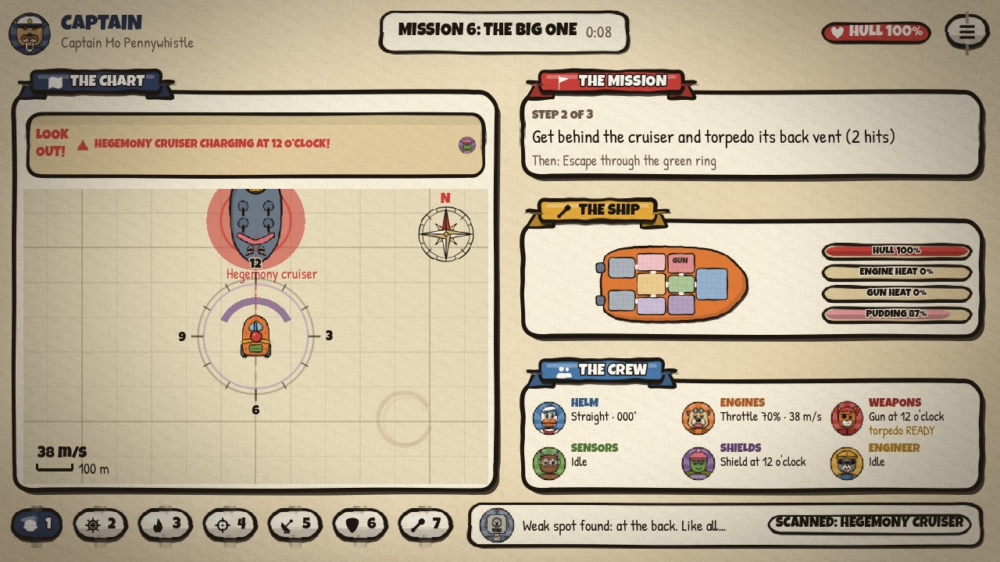
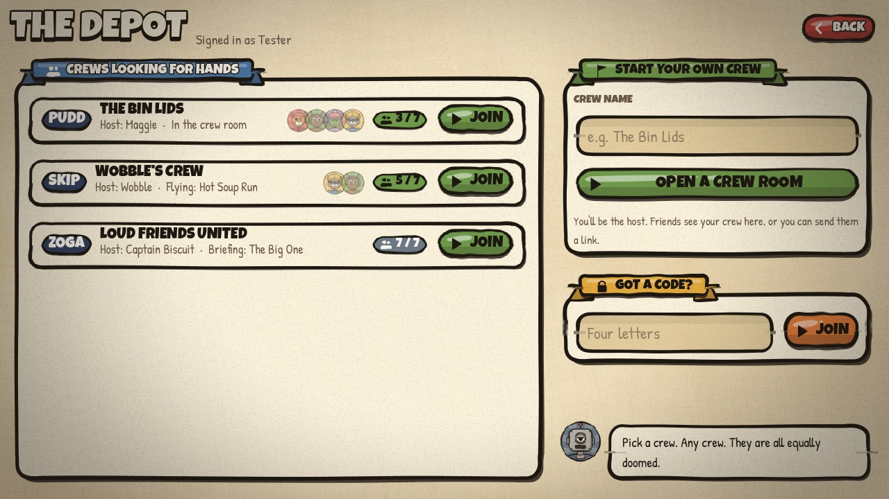
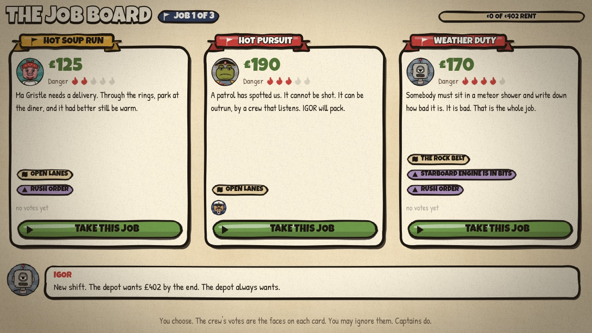
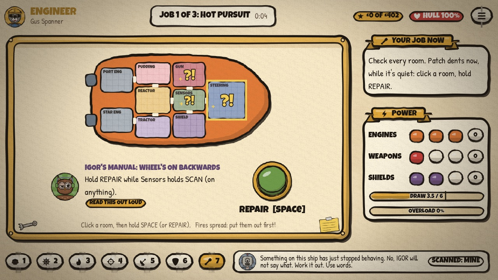
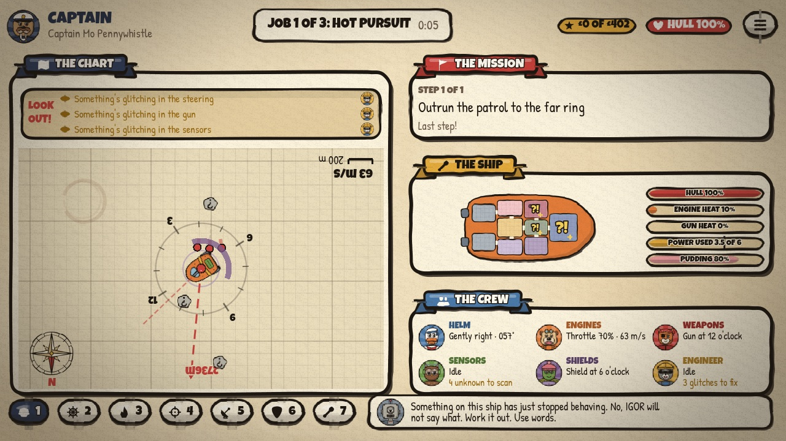
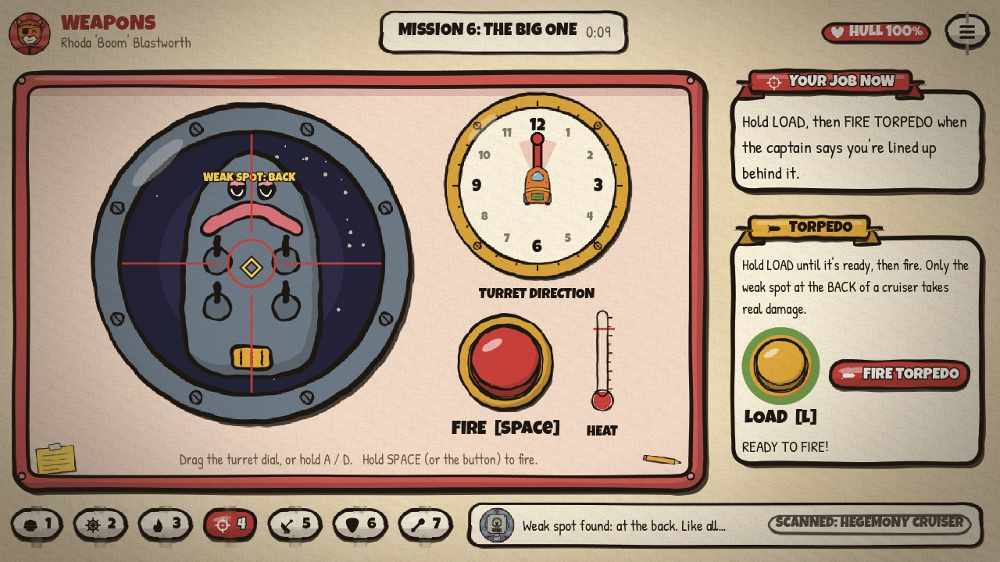
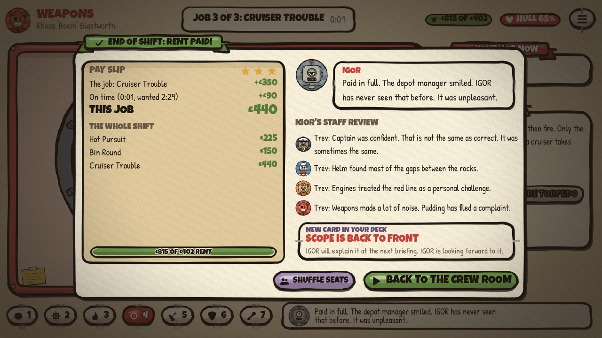

# YES, CAPTAIN!

A **bridge simulator for loud friends**, in a hand-inked 1930s cartoon style. Played in the browser, hosted
from one Docker container.

> The captain sees everything and touches nothing.
> Everyone else touches one thing and sees almost nothing.
> The only way to fly is to talk. Constantly.



You're the crew of a garbage hauler from the Free Lanes. On bin day you collect a skip and find **Pudding**
inside: the beloved pet of the Hegemony's Overlord. Now the whole Hegemony fleet wants Pudding back, the ship's
robot **IGOR** thinks you are all idiots, and the ship keeps breaking.

Built with **Godot 4.7** (GDScript only, Compatibility renderer).

---

## How a session goes

1. **Open the page.** Type a name, *Find a crew online*.
2. **The Depot** lists every crew that's open. Join one, or open your own crew room and send friends the link.
3. **The Crew Room.** Take a seat, or a **pair** of seats. Everyone presses *I'm ready*; the host starts.
4. **IGOR's briefing**, read aloud and subtitled. Then a 3-second countdown.
5. **Fly it.** Shout.
6. **Debrief:** stars or a pay slip, crew awards, *Shuffle seats* so somebody else gets to be captain.



## The idea

The fun lives in the gap between two kinds of knowledge:

- **The Captain** has the big picture and no controls at all: a chart of everything around the ship, the goal,
  a board of every ship system, what each crew member is doing, and **forecasts** such as *"Reactor overload in
  5s"*, each showing whose face to shout at.
- **The crew** each see one thing in depth. Helm only has a compass. Weapons only sees down the gun barrel.
  Engines can't see where the ship is going. The server only sends each seat what that seat may know.

The seats also need **each other**, not just the captain:

| Rule | Who has to talk |
|---|---|
| The ship turns tighter when it's slow | Helm and Engines |
| A part mends twice as fast while nobody is using it | Engineer and whoever is using it |
| Scanned enemies get an aiming mark in the gun scope | Sensors and Weapons |

## The seats

| Seat | Persona | Hero control | Unlocks later |
|---|---|---|---|
| **Captain** | Captain Mo Pennywhistle (walrus) | None. Voice only. | |
| **Helm** | Dex Wheelwright (duck) | Ship's wheel | Barrel roll |
| **Engines** | Big Sal Throttleby (bulldog) | Brass throttle | Heat, boost |
| **Weapons** | Rhoda "Boom" Blastworth (cat) | Turret dial + FIRE, through a periscope | Gun heat, torpedoes |
| **Sensors** | Ozzy Squint (owl) | Radar: click a blip, hold SCAN | Comms dial, weak-spot scans |
| **Shields** | Nana Fluffington (turtle) | Shield dial, marked like a clock | Tractor beam, Pudding care |
| **Engineer** | Gus Spanner (raccoon) | Ship cutaway: click a room, hold REPAIR | Power bars, IGOR's manual |

**Small crews take pairs.** One player holds two stations and flips between the two screens with **F**:
**Pilot** (Helm + Engines), **Gunner** (Weapons + Shields), **Tech** (Sensors + Engineer). Four players crew the
whole ship. Robots (IGOR's relatives) fill whatever is left. The Captain must be a human.

## Training: one new thing per mission

| # | Mission | New today |
|---|---|---|
| 1 | Driving Lesson | The basics: steer, throttle, scan, shoot, shield, repair |
| 2 | Bin Day | **Tractor beam**, and the discovery of Pudding |
| 3 | Running Hot | **Heat**: full throttle and non-stop firing overheat things, and things catch **fire** |
| 4 | Pet Sitting | **Pudding's mood**: upset Pudding escapes and chews the ship |
| 5 | Customs | **The comms dial**: only Sensors can hear the officer's demands |
| 6 | The Big One | **Torpedoes and weak spots** |
| 7 | Hot Pursuit | **Boost and barrel roll** |
| 8 | Brownout | **Power and overload** |
| 9 | Grabbers | **Grabber drones** |
| 10 | Run to Haven | Everything at once |

## The Shift: never the same twice

Once two missions are flown, the Crew Room opens **the Shift**: three jobs, and rent to make.



- **Jobs are dealt, not written:** a task (eight of them) x a place (rock belt, minefield, fog...) x one or two
  snags (rush order, second-hand ship, Thrupp is watching...). The crew votes on the job board; the captain picks.
  Safer jobs pay less.
- **A director drops trouble in as you fly:** drones, meteors, stray cargo worth a bonus, and radio calls only
  Sensors can hear ("Hello! Have you considered extended hull warranty? To decline, point your gun at 6 o'clock").
  It backs off when the crew already has its hands full.
- **Glitches.** The ship stops behaving and nobody is told what: the wheel is on backwards, the compass is
  drunk, the captain's chart turns upside down. The Engineer finds the room marked **?!** and reads **IGOR's
  manual** out loud; the fix always needs *somebody else* to do something with their own control while the
  Engineer holds REPAIR.
- **IGOR found a part:** between jobs, fit one bodged upgrade with a catch (*bigger engine, runs hot*).
- **The deck grows.** Every finished shift adds exactly one new card (a glitch, a place or a snag), introduced
  by IGOR at the next briefing. The one-new-thing rule, carried on for ever.

| | |
|---|---|
|  |  |
|  |  |

## Run it

**On a server (the real thing):** see [docs/DEPLOY.md](docs/DEPLOY.md). One container, one web address.

**On this computer:**

```bash
godot --path .
```

| Title screen | What it does |
|---|---|
| **Play with a robot crew** | A game in this window; robots run every seat you don't take. |
| **Join a server** | Type a server's address (desktop build). The browser build finds its own server. |
| **Host on this network** | Friends with the desktop build join your address directly (port 7777). |

**A server without Docker**, for trying things out:

```bash
scripts/build_web.sh                                              # exports the browser build to export/web
godot --headless --path . scenes/main.tscn -- --server --port=7777 # the room server
python3 -m http.server 8060 --directory export/web                # serves the page
# then open  http://localhost:8060/?server=ws://localhost:7777
```

**Voice chat** is built in for crews in different places: the host switches it on in the Crew Room, each player
has a mute button (**M**). It needs an `https` address; the browser will ask for the microphone.

### Keys

| Seat | Keys |
|---|---|
| Any | **F** flip to your other seat, **1-7** pick a seat, **Esc** or **`** menu, **M** mute |
| Helm | **A / D** turn the wheel, **S** straighten up, **R** barrel roll |
| Engines | **W / S** throttle, **X** all stop, **B** boost |
| Weapons | **A / D** turn the turret, **Space** fire, **L** load torpedo, **T** fire torpedo |
| Sensors | **R** (or Tab) next blip, **Space** scan, **Q / E** comms dial |
| Shields | **A / D** turn the shield, **T** tractor, **P** pet Pudding, **C** shake the tin, **N** snack |
| Engineer | Click a room, **Space** repair |

## Project layout

```
sim/        the rules, no nodes: Ship, World, Mission + Missions (training), Jobs (the Shift's dealt jobs and
            their director), Glitches, Deck (the cards a crew holds), Intents, Snapshots (what each seat may know)
net/        Hub (the server's rooms), GameHost (one crew's game: seats, robots, briefing, the Shift, debrief),
            Net (WebSocket glue for server, local play and clients)
bots/       the robot crew: they work the same controls as humans
run/        Progress (a crew's career; it lives in the host player's browser)
captain/    the Captain's Table
stations/   one screen per crew seat
ui/         the design system (UIK, Art, InkBox, Paper, Film, Fx, Face), widgets, title card, the Depot, Crew Room,
            briefing, job board, debrief, voice chat, LayoutCheck
content/    IGOR's lines and the sound
assets/     generated SVG art, the music loop, the bundled fonts
tools/      make_art.py (all the art) and make_music.py (the music): everything is generated
deploy/     Dockerfile, entrypoint, web page shell, voice.js, Unraid template
tests/      headless tests
docs/       DEPLOY.md, V3_ONLINE_PLAN.md (the design behind this version), older design notes
```

## Tests and tools

```bash
scripts/run_tests.sh          # everything (about 5 minutes)
scripts/run_tests.sh quick    # one seed per mission
NOWINDOW=1 scripts/run_tests.sh   # skip the windowed layout checks (no display)
```

The suite covers:
- a robot crew beating all 10 missions, and flying every kind of dealt job with places, snags and glitches on;
- a whole Shift run by the host, and the glitch plumbing (bent controls, bent screens, the manual);
- the room server: the Depot, create and join by code, two rooms flying at once with nothing crossing between
  them, seat secrecy, ready-up, kick, room limits, flooding and rubbish input;
- UI smoke tests that visit every seat and press every control;
- a host plus a separate client process over the network;
- **layout checks** of every screen at four window sizes, including a browser-shaped one.

Flags for the main scene (after `--`): `--server`, `--port=N`, `--solo`, `--host`, `--join=IP`, `--room=CODE`,
`--layoutcheck`, `--autotest=<mission>`, `--readmeshots=DIR`, `--shiftshots=DIR`, `--tour`, `--nograin`.

Regenerate the art with `python3 tools/make_art.py` and the music with `python3 tools/make_music.py`.

## Notes

- Fonts: [Luckiest Guy](https://fonts.google.com/specimen/Luckiest+Guy) (Apache 2.0) and
  [Patrick Hand](https://fonts.google.com/specimen/Patrick+Hand) (SIL OFL), bundled with their licences.
- The setting, the art and the music are original and generated by the scripts in `tools/`.
- All balance numbers were tuned with robot crews. Expect to retune once humans play.
