# YES, CAPTAIN!

A **bridge simulator for four loud friends**, in a hand-inked 1930s cartoon style. Played in the browser on
phones and laptops, hosted from one Docker container.

> The captain sees far ahead and touches nothing. The Tech sees all round.
> Everyone else works two controls and sees almost nothing.
> The only way to fly is to talk. Constantly.

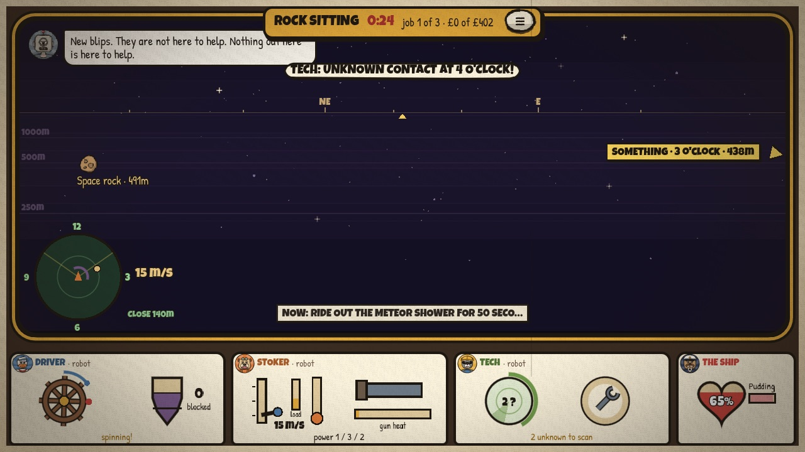

You're the crew of a garbage hauler from the Free Lanes. On bin day you collect a skip and find **Pudding**
inside: the beloved pet of the Hegemony's Overlord. Now the whole Hegemony fleet wants Pudding back, the ship's
robot **IGOR** thinks you are all idiots, and the ship keeps breaking.

Built with **Godot 4.7** (GDScript only, Compatibility renderer).

---

## How a session goes

1. **Open the page** on a laptop hooked up to the TV. Type a name, *Find a crew online*, *Open a crew room*.
   Whoever opens the room starts as the **Captain**.
2. **Everyone else scans the QR code** on the TV with their phone (or goes to the address and types the big
   four-letter code). The invite link works too.
3. **Take a seat.** That's all: no ready button. Robots take any role nobody wants.
4. **IGOR's briefing.** The story and the plan play on the Captain's screen, read aloud and subtitled; each phone
   shows only what's new and *your* two jobs. Everyone presses ready, or the Captain launches.
5. **Fly it.** Shout.
6. **Debrief:** stars or a pay slip, crew awards, *Shuffle seats* so somebody else gets to be Captain.

| | |
|---|---|
| 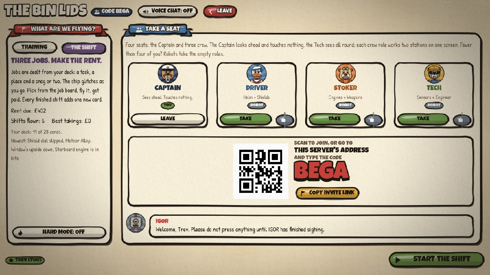 | 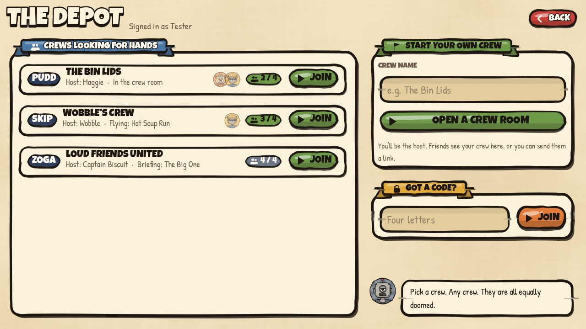 |

## The idea

The fun lives in the gap between two kinds of knowledge:

- **The Captain** has no controls at all. They look out of the **bridge window**: about 110 degrees wide and
  1.3 km deep, but **nothing to the sides or behind** (bar a small close-range ring for things about to bump
  the hull). Under it, a console for each crew role showing who's at it and what their instruments say, and
  **forecasts** such as *"Reactor overload in 5s"*.
- **The Tech's radar sees all round, and further.** When something is sneaking up behind, the Tech taps it and
  presses **SHOW CAPTAIN**: a marker appears on the edge of the Captain's window (*"DRONE · 5 o'clock · 400m"*)
  for 15 seconds. Tap the goal on the radar to show the Captain which way to go.
- **The crew** each see their own desk in depth and nothing else. The Driver only has a compass. The Stoker only
  sees down the gun barrel and can't see where the ship is going. The server only sends each player what their
  seat may know.

The roles are grouped so that **no crew member can manage without the Captain** (the radar is never on the same
desk as the wheel, the gun or the shield), and so the crew still need **each other**:

| Rule | Who has to talk |
|---|---|
| The ship turns tighter when it's slow | Driver and Stoker |
| Turning the ship moves where the danger is | Driver (wheel) and Driver (shield): one shout, two jobs |
| The Captain only sees ahead; the radar sees all round | Tech and Captain: "drones behind us, 5 o'clock!" |
| Scanned enemies get an aiming mark in the gun scope | Tech and Stoker |
| A part mends twice as fast while nobody is using it | Tech and whoever is using it |
| A glitch fix needs someone else to do something while the Tech holds REPAIR | Always a third role |

## The crew: four seats

| Seat | Character | Works | Desk |
|---|---|---|---|
| **Captain** | Captain Mo Pennywhistle (walrus) | Nothing. Voice only. | The bridge window and four consoles |
| **Driver** | Dex Wheelwright (duck) | Helm + Shields | Hold LEFT / RIGHT to turn, compass, drag the shield dial; barrel roll; keep Pudding calm |
| **Stoker** | Big Sal Throttleby (bulldog) | Engines + Weapons | Throttle and heat on the left, gun scope, turret dial and FIRE on the right; boost, reactor power, torpedoes |
| **Tech** | Gus Spanner (raccoon) | Sensors + Engineer | Radar (all round, long range): pick a blip, hold SCAN or PULL (tractor beam), SHOW CAPTAIN; ship plan: pick a room, hold REPAIR; IGOR's manual |

| | | |
|---|---|---|
| 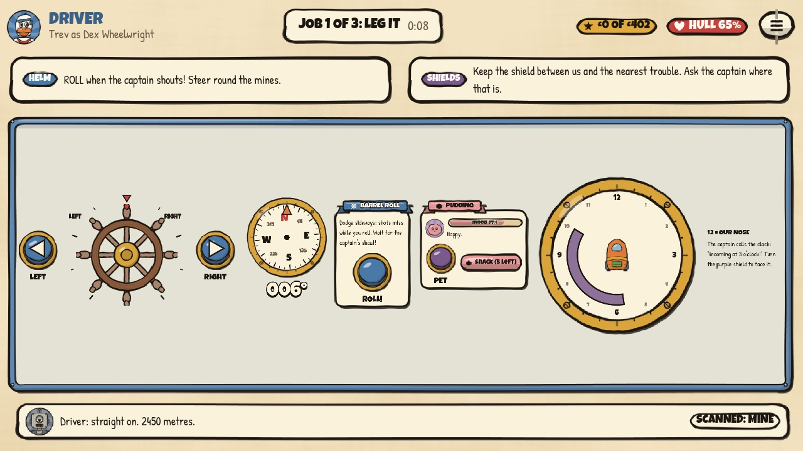 | 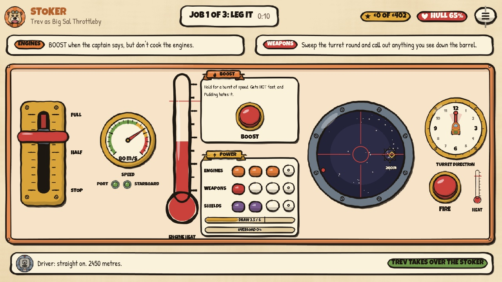 | 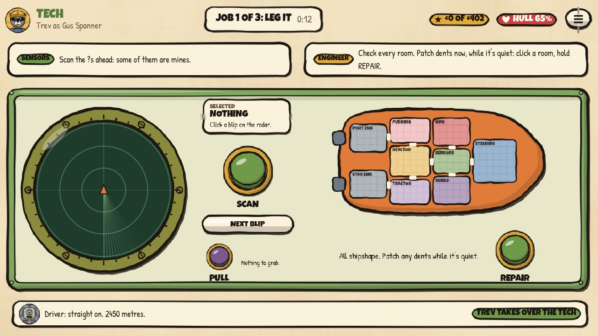 |

**Fewer than four of you?** Robots (IGOR's relatives) take the empty roles. With two or more humans the Captain
must be one of them. **On your own**, choose *Practise with robots*, take any seat, and **IGOR captains**: he reads
out each goal and calls the turns, targets, scans and repairs for your role.

**Late?** Anyone who arrives mid-shift can take over a robot's role on the spot.

## Phones first

Three of the four players are usually on phones, so:

- **Both thumbs work at once** on every desk: hold FIRE while turning the turret, hold LEFT while swinging the shield.
- **Held upright**, the title, the crew list and the Crew Room go to one column; once the game starts it asks to be
  turned sideways (with a full-screen button that also locks landscape where the phone allows).
- **Finger-sized buttons** (at least 44 px on a phone), and keyboard hints only appear once someone presses a key.
- **Tap anything with a "?"** (or press and hold a button) to see what it does. Tooltips can't hover on a phone.
- **Dropped out?** A phone that loses its connection shows *Reconnecting...* and gets back in by itself, to the same
  seat. A robot holds the seat meanwhile. The screen is kept awake so phones don't doze off during briefings.
- **Typing** uses the phone's own text box, so every keyboard (and paste, and autofill) works.

| | | |
|---|---|---|
| 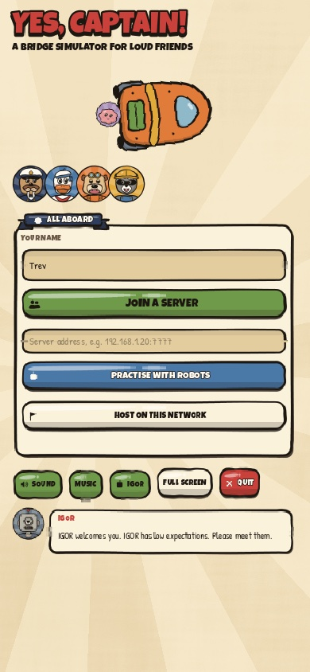 | 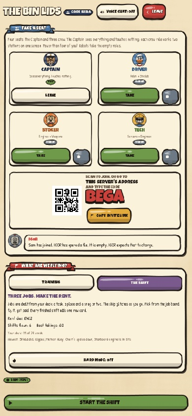 | 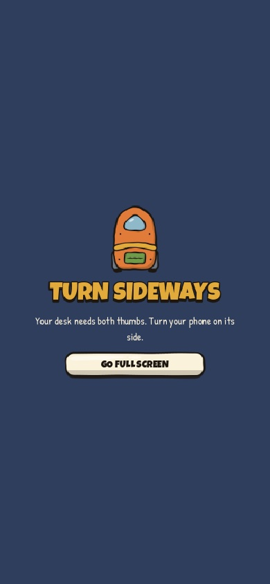 |

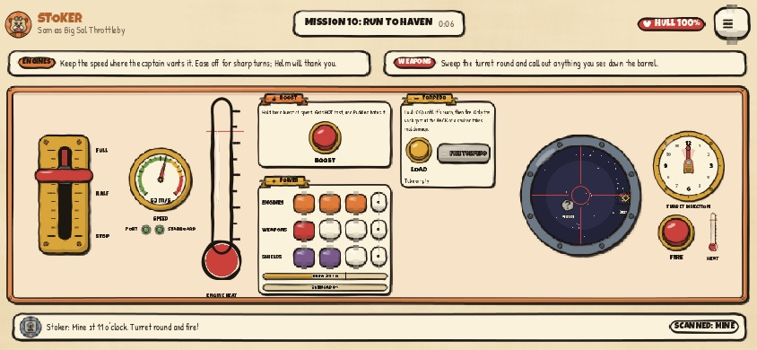

## Training: one new thing per mission

| # | Mission | New today |
|---|---|---|
| 1 | Driving Lesson | The basics: steer, throttle, scan, shoot, shield, repair |
| 2 | Bin Day | **Tractor beam** (the Tech), and the discovery of Pudding |
| 3 | Running Hot | **Heat**: full throttle and non-stop firing overheat things, and things catch **fire** |
| 4 | Pet Sitting | **Pudding's mood**: upset Pudding escapes and chews the ship |
| 5 | Customs | **The comms dial**: only the Tech can hear the officer's demands |
| 6 | The Big One | **Torpedoes and weak spots** |
| 7 | Hot Pursuit | **Boost and barrel roll** |
| 8 | Brownout | **Power and overload** (the Stoker shares out the reactor) |
| 9 | Grabbers | **Grabber drones** |
| 10 | Run to Haven | Everything at once |

## The Shift: never the same twice

Online rooms open on **the Shift**: three jobs, and rent to make.

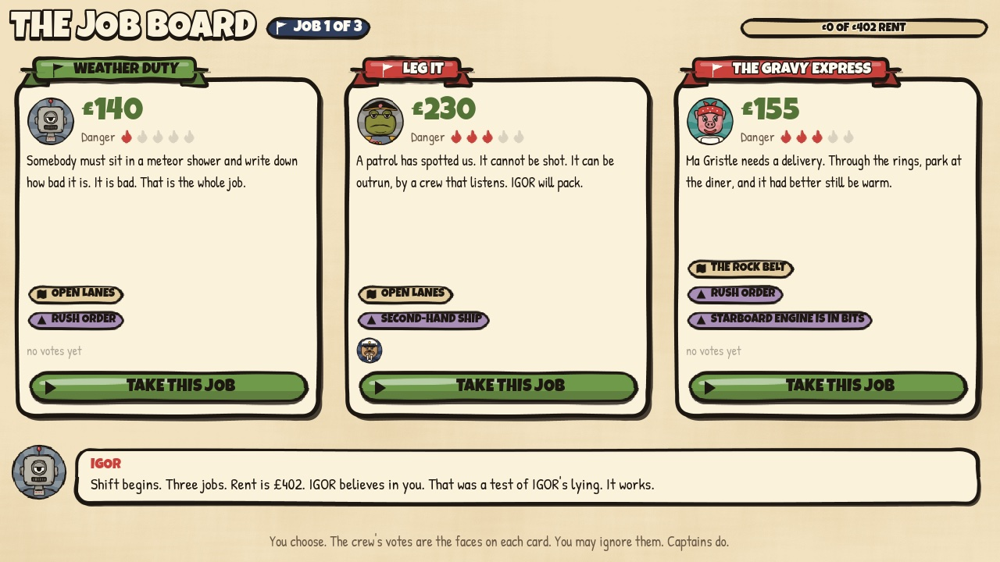

- **Jobs are dealt, not written:** a task x a place (rock belt, minefield, fog...) x one or two snags (rush order,
  second-hand ship, Thrupp is watching...). The crew votes on the job board; the Captain picks. Safer jobs pay less.
- **A director drops trouble in as you fly:** drones (they glow for two seconds, then fire three shots at once), meteors, stray cargo worth a bonus. It waits until the crew
  is clear of the last lot, so there's time to spot it, say it and do it.
- **Glitches.** The ship stops behaving and nobody is told what: the wheel is on backwards, the compass is drunk,
  the Captain's window turns upside down. The Tech finds the room marked **?!** and reads **IGOR's manual** out
  loud; the fix always needs a crew member in *another* role to do something with their own control while the
  Tech holds REPAIR.
- **IGOR found a part:** between jobs, fit one bodged upgrade with a catch (*bigger engine, runs hot*).
- **Hard mode** (a Crew Room switch): radio calls only the Tech can hear, torpedoes and weak spots, and trouble
  arriving twice as fast.

| | |
|---|---|
| 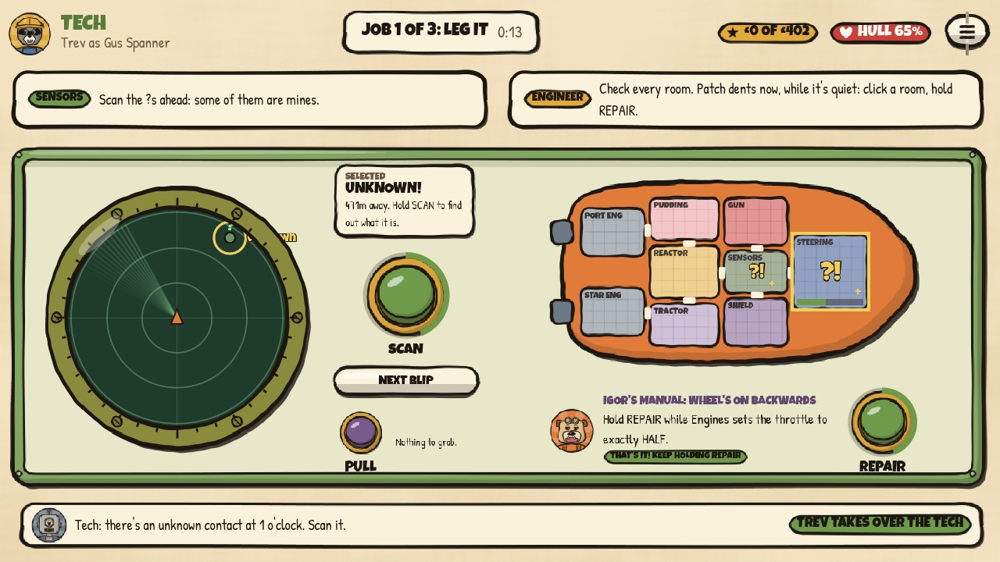 | 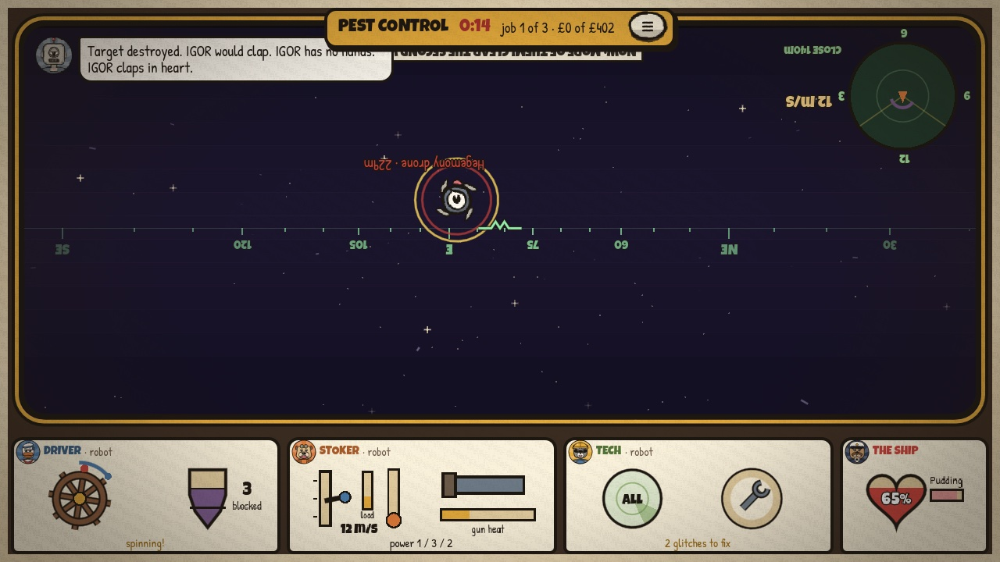 |
| 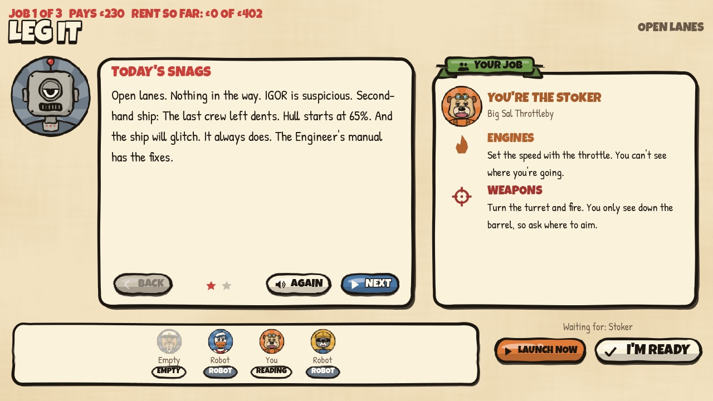 | 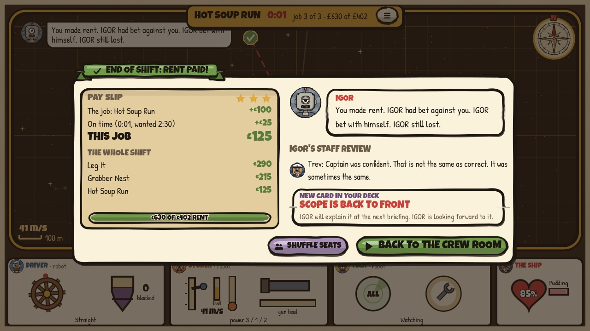 |

## Run it

**On a server (the real thing):** see [docs/DEPLOY.md](docs/DEPLOY.md). One container, one web address.

**On this computer:**

```bash
godot --path .
```

| Title screen | What it does |
|---|---|
| **Practise with robots** | A game in this window; robots run every seat you don't take, and IGOR captains if you don't. |
| **Join a server** | Type a server's address (desktop build). The browser build finds its own server. |
| **Host on this network** | Friends with the desktop build join your address directly (port 7777). |

**A server without Docker**, for trying things out:

```bash
scripts/build_web.sh                                              # exports the browser build to export/web
godot --headless --path . scenes/main.tscn -- --server --port=7777 # the room server
python3 -m http.server 8060 --directory export/web                # serves the page
# then open  http://localhost:8060/?server=ws://localhost:7777
```

**Voice chat** is built in for crews in different places: the host switches it on in the Crew Room, each player
has a mute button (**M**). It needs an `https` address; the browser will ask for the microphone.

### Keys

Every desk works with mouse or touch; keys are there for laptop players. **Rebind them** from the menu
(**Esc**, then *Keys*); your choices are saved in your browser.

| Seat | Keys (defaults) |
|---|---|
| Any | **Esc** or **`** menu, **M** mute |
| Driver | **A / D** (or arrows) hold to turn, **R** barrel roll, **Q / E** swing the shield, **P** pet Pudding, **C** shake the tin, **N** snack |
| Stoker | **W / S** throttle, **X** all stop, **B** boost, **A / D** turn the turret, **Space** fire, **L** load torpedo, **T** fire torpedo |
| Tech | **Tab** next blip, **Space** scan, **T** tractor beam, **P** show the Captain, **Q / E** comms dial, **R** repair (click a room first) |

## Project layout

```
sim/        the rules, no nodes: Ship, World, Mission + Missions (training), Jobs (the Shift's dealt jobs and
            their director), Glitches, Deck, Intents, Snapshots (what each seat may know), K (the four roles)
net/        Hub (the server's rooms), GameHost (one crew's game: seats, robots, IGOR as captain, the Shift,
            reconnecting), Net (WebSocket glue for server, local play and clients)
bots/       the robot crew: they work the same controls as humans
run/        Progress (a crew's career; it lives in the host player's browser)
captain/    the Captain's bridge
stations/   the six station screens, and RoleDesk (a role's two stations on one console)
ui/         the design system (UIK, Art, InkBox, Paper, Film, Fx, Face), widgets (FitBox, Pointer for
            multi-touch...), title card, the Depot, Crew Room, briefing, job board, debrief, voice chat, Qr,
            Keys, Explain (tap to explain), LayoutCheck
content/    IGOR's lines and the sound
assets/     generated SVG art, the music loop, the bundled fonts
tools/      make_art.py (all the art), make_music.py (the music), mock-up renderers
deploy/     Dockerfile, entrypoint, web page shell (wake lock, native text box), voice.js, Unraid template
tests/      headless tests, and a QR reader check (qr_decode.swift, macOS)
docs/       DEPLOY.md, V3_ONLINE_PLAN.md, older design notes, screenshots
```

## Tests and tools

```bash
scripts/run_tests.sh          # everything (about 10 minutes)
scripts/run_tests.sh quick    # one seed per mission
NOWINDOW=1 scripts/run_tests.sh   # skip the windowed checks (no display)
```

The suite covers:
- a robot crew beating all 10 missions, and flying every kind of dealt job with places, snags and glitches on;
- a whole Shift run by the host, and the glitch plumbing (bent controls, bent screens, the manual);
- IGOR captaining a lone player: a Driver following only his calls gets through the first mission;
- the room server: the Depot, create and join by code, two rooms flying at once with nothing crossing between
  them, seat secrecy, whole-role seats, reconnecting (silently dead and properly dropped connections), taking over
  a robot mid-mission, kick, room limits, flooding and rubbish input;
- QR codes made by the game, read back by macOS's own QR reader;
- two thumbs at once on the Stoker's and Driver's desks, tap and hold to explain, and rebinding keys;
- UI smoke tests that visit every seat and press every control;
- a host plus a separate client process over the network;
- **layout checks** of every screen at six window sizes, plus phone sizes upright and sideways with touch-sized
  buttons.

Flags for the main scene (after `--`): `--server`, `--port=N`, `--solo`, `--host`, `--join=IP`, `--room=CODE`,
`--layoutcheck` (with `--touchui` for touch-sized buttons and `--targets=44` to flag small ones),
`--touchtest`, `--autotest=<mission>`, `--readmeshots=DIR` and `--phoneshots=DIR` (these screenshots; the phone
ones at `--resolution 390x844 --touchui`), `--shiftshots=DIR`, `--tour`, `--nograin`.

Regenerate the art with `python3 tools/make_art.py` and the music with `python3 tools/make_music.py`.

## Notes

- Fonts: [Luckiest Guy](https://fonts.google.com/specimen/Luckiest+Guy) (Apache 2.0) and
  [Patrick Hand](https://fonts.google.com/specimen/Patrick+Hand) (SIL OFL), bundled with their licences.
- The setting, the art and the music are original and generated by the scripts in `tools/`.
- Balance was tuned with robot crews. The server keeps a log of real crews' jobs (see
  [docs/DEPLOY.md](docs/DEPLOY.md)) for retuning par times and pay.
