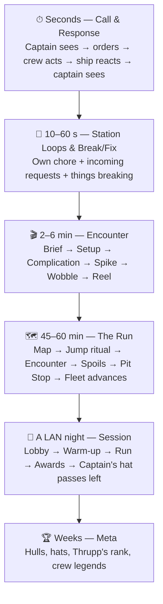

# YES, CAPTAIN — Game Loops & Where the Fun Comes From

This doc covers what players actually *do*, second by second up to night by night, and the
specific mechanisms that turn that into funny moments.

**Design targets:**
- **Overcooked busy:** there's always something to do, and each task is simple. Difficulty
  comes from volume, interruptions, and handoffs.
- **Cosmoteer chaos:** the ship is made of physical parts, and parts break in ways that cause
  emergent slapstick. Lose an engine and you spin.
- **Almost in control:** chaos rises until it's *nearly* overwhelming and then gives the crew a breath.
  Players should always feel "we could have caught that", never "the game just killed us".
- **The captain is the hub:** the captain sees and knows things nobody else does, and the crew
  has hands and nobody to tell them where to point them.

---

## 1. The loop stack



Each loop feeds the one above it. Funny moments come from the bottom two loops.
Stories come from the middle. Reasons to come back come from the top two.

---

## 2. Seconds: the Call & Response loop

```
 CAPTAIN sees something ──► CAPTAIN gives an order ──► CREW acknowledges ("Yes, Captain!")
        ▲                                                       │
        │                                                       ▼
 CAPTAIN sees the result ◄── SHIP reacts (with inertia) ◄── CREW acts on their station
```

This loop is the game. Everything below is about putting friction into it in funny places:

- **Inertia means the result lags the order.** The ship keeps turning after Helm lets go, which
  leads to overcorrection: "Stop! STOP! Other way! Too far!"
- **Frame of reference confuses people.** Crew stations say **PORT** and **STARBOARD**, while the
  captain thinks in screen-left and screen-right. When Sensors swings the viewscreen to face aft,
  **left and right flip** for the captain. This is a deliberate, permanent source of chaos.
- **Partial information.** The captain sees the asteroid but not the distance. Sensors sees the
  distance but not what the asteroid is. Helm sees neither.
- **Competing orders.** The captain asks Power for engines, Weapons is begging Power for
  guns, and Power has one pip left.
- **Interruptions.** A request arrives right as a station is in the middle of fixing something else.

**Rule:** the captain never touches the ship. Their only inputs are accepting or dismissing a
shared screen, choosing the viewscreen when no Sensors officer is present, issuing orders to *AI crew*
(section 10), and signing off spending at the Pit Stop.

---

## 3. Station loops (10–60 seconds)

Every crew station runs the same mini-loop:

```
  your CHORE drifts ──► tend it ──► a REQUEST arrives ──► juggle ──► something BREAKS ──► fix or ask for help
        ▲                                                                                     │
        └─────────────────────────────────────────────────────────────────────────────────────┘
```

- **The chore** is a background task that slowly goes wrong if ignored, so nobody is ever
  idle. It's the Overcooked equivalent of washing dishes.
- **Requests** come from the captain and other crew. They compete with the chore.
- **Breaks** come from the damage model (section 4). They're the spice.
- Each station also has **one spicy control** that's powerful and hilarious when misused.

| Station | Core verb | Chore (drifts if ignored) | Spicy control | Needs from others | Typical breakage |
|---|---|---|---|---|---|
| **Helm** | Point the ship: yaw and strafe | **Trim drift:** gravity wells, venting breaches, and lopsided thrust pull the heading off | **Emergency Roll** | Where to point (Captain, Sensors), turn power (Power) | An RCS quad dies, so the ship turns fast one way and like a fridge the other |
| **Engines** | Speed: per-engine throttles (linked by default), forward and reverse | **Engine heat and fuel mixture:** a mixture needle wanders, and outside the green band you get less thrust and more heat | **Dampers OFF**, making the ship fully Newtonian | Thrust power (Power), "how fast?" (Captain) | One engine dies or sticks at full, so the throttles **unlink** and Engines has to balance two levers by hand to fly straight |
| **Power** | Allocate a fixed pool of power pips across systems | **Reactor heat:** pump coolant and vent heat. A hot reactor sheds pips | **Overclock:** +50% to one system until the reactor scrams and everything goes dark for 5 s | Priorities (Captain) | Conduits cut, so systems downstream go dark until power is rerouted or the conduit repaired. Breakers trip |
| **Weapons** | Aim within turret arcs, fire, and load torpedoes | **Loading:** drag shells into breeches, vent barrel heat, and torpedo tubes need hand-arming | **Torpedoes**, which can't tell friend from foe from cargo | A scan lock (Sensors), the arc (Helm), charge (Power), bay doors open (Ops) | A turret jams mid-rotation, a tube door is stuck, or the gun scope is cracked |
| **Sensors & Comms** | Find, identify, and tune | **Contact decay:** scans go stale and need refreshing. Comms frequency drifts, so the captain loses Thrupp's audio and enemy hails | **Active Ping**, which reveals everything and tells everyone where you are | Range power (Power) | Radar ghosts (fake contacts), the display mirrors, and comms produce static or crossed lines |
| **Ops** *(optional; merges into Power when not filled)* | Shield facing, tractor beam, cargo, repair bots | **Pudding & cargo:** keep Pudding calm with snacks, pats, and music, or it escapes and eats wiring. Ridiculous cargo needs tending too (the cheese destabilizes) | **Jettison** | Shield pips (Power), where hits come from (Sensors) | A shield emitter dies so one facing is open, the tractor beam stutters, or the cargo doors are stuck open |

**When a station is unmanned**, it holds its last settings, so the chore drifts and nobody
answers requests. Alternatively an AI temp fills in (section 10).

---

## 4. The ship is made of parts, and parts break (Cosmoteer chaos)

### 4.1 A ship is a grid of physical modules
The ship is a small 2D grid layout, defined in data:

```
          [Sens] [Brdg] [Sens]
   [RCS]  [Shld] [Turr] [Shld]  [RCS]
          [Pwr ] [Rctr] [Cool]
   [RCS]  [Crgo] [Crgo] [Ops ]  [RCS]
          [Eng-P]  [Tube]  [Eng-S]
```

- **Thrusters are physical.** Each engine and RCS thruster applies its force *at its position*.
  The sim adds up forces and torques. With both main engines healthy, the ship goes straight.
  When the port engine dies, the starboard engine pushes off-centre and the ship spins. **We
  don't script this. It falls out of the physics**, which is exactly why Cosmoteer is funny.
- **Power flows through conduits** from the reactor to modules. Cut a conduit and everything
  downstream goes dark.
- **Adjacency matters.** Fire spreads to neighbouring modules, and a breach next to cargo can
  suck the cargo out.
- **Hull breaches vent atmosphere, and venting is thrust.** A breach acts like a tiny, rogue
  thruster that slowly pushes or spins the ship until it's sealed.
- Different hulls have different layouts. The ice-cream van has its engines off-centre on
  purpose, so it always wants to spin left.

### 4.2 Everything breaks, and everything can be fixed
**Unlike Cosmoteer, no part is ever permanently lost.** Every module can be fully repaired
mid-flight, back to 100%. Breakage is a *temporary* problem the crew has to **find and fix**,
not attrition that slowly cripples the ship. The cost of a breakage is **time and attention**:
who leaves their post, for how long, and what drifts while they're gone.

- Modules go down to **Failed** but never to "Destroyed".
- Repairs are free. They cost no resources, only hands and seconds.
- A repaired module gets a cosmetic **duct-tape patch** (fully working), so the ship *looks*
  more battle-scarred as the run goes on, which is a nice visual record of the chaos.
- What persists across a run is **Hull Integrity**, the ship's overall health bar. It's how
  you lose a run, and it can only be fully restored at a Pit Stop. Parts break and get fixed;
  the hull slowly wears.

### 4.3 How a module fails
Damage hits a location, and modules near that location take damage. Each module degrades
through visible stages, and a repair restores it from any stage:

| Stage | Example: an engine | Telegraph |
|---|---|---|
| **OK** | Full thrust | — |
| **Rattling** | Thrust sputters ±15% | Smoke puffs on the captain's view, a rattle SFX, and an amber icon on the owning station |
| **Faulted** | Thrust stuck at its last value, or 50% output | Sparks. IGOR: *"Port engine is coughing. Like human in morning."* |
| **Failed** | Zero thrust, or stuck at FULL | Fire. The module goes red on every schematic |
| **Cascading** | Fire spreads to its neighbours | Alarms and bridge-cam crew panicking |

**Telegraphing is essential to the balance.** Things wobble before they break, so an alert crew can
catch them. Chaos feels fair when you saw it coming and couldn't get to it in time.

### 4.4 The failure catalogue (designed to be funny)
| Failure | What happens | Who's affected | Fix |
|---|---|---|---|
| One main engine out | The ship spins toward the dead side | Helm fights it and Engines unlinks the throttles | Repair the engine, or counter-trim |
| Engine **stuck at full** | The ship won't stop accelerating | Everyone | Power cuts that engine's power, which also kills something else on the same conduit |
| RCS quad out | Turns one way fine and very slowly the other way. "Go *right*… the long way round" | Helm | Repair it, or turn 270° the other way |
| Hull breach | Venting acts as thrust, causing slow spin or drift | Helm, Engines | Seal the breach: a Damage Control task |
| Conduit cut | Downstream modules go dark | Whoever owns them | Power reroutes (a pipe puzzle) or repairs the conduit |
| Reactor scram | Everything goes dark for 5 s, including the captain's screen (emergency lighting) | Everyone | Wait it out. IGOR: *"Is dark now. Is like home."* |
| Sensors mirrored | The radar is flipped left-right | Sensors, and the captain if shared | Recalibrate (a quick minigame), or just cope |
| Turret jammed rotating | It sweeps and fires at random in an arc | Weapons, plus everyone nearby | Weapons can only fire while it points the right way |
| Cargo doors stuck open | Cargo drifts out whenever the ship accelerates | Ops, Engines (accelerate gently!) | Repair the doors |
| Fire | Spreads to neighbours | Whoever owns the burning modules | Vent the compartment, which causes a breach, which causes thrust. Choose your poison. |
| Coolant leak | The captain's window fogs up | Captain | Ops repair, or Power vents it |
| Pudding is loose | Anxious Pudding wanders into modules and eats wiring, cutting conduits | Random (it follows the noise) | Ops lures it back with snacks, then calms it before it bolts again |

### 4.5 Find it, then fix it
The repair loop has a **finding** step on purpose, because "what's broken?" is a
communication problem in its own right:

```
 SYMPTOM ──► DIAGNOSE ──► LOCATE ──► FIX ──► back to your post
 (someone notices    (whose problem    (where on    (repair
  something wrong)    is it?)           the ship?)   task)
```

- **Symptoms appear where they're felt, not where they're caused.** Helm feels the ship
  pulling to port, but the cause is the port engine (Engines' system), a hull breach venting
  (a Damage Control job), or Pudding chewing an RCS conduit. The captain sees smoke from one
  side of the ship. The crew has to talk it out and work out what's actually wrong.
- **Obvious faults are marked straight away.** A burning engine is red on every schematic.
- **Hidden faults have to be traced.** A cut conduit shows as "everything downstream is dark",
  and someone has to follow the line on the Damage Control schematic to find the break. A
  slow breach shows only as drift until Sensors runs an **internal scan** to pinpoint it.
- **Finding is quick (5–15 s), never a hunt.** It's a moment of "where is it? There! Port side,
  aft!" rather than a puzzle.

### 4.6 Repairs pull people away from their posts (on purpose)
Repairs come in two tiers, both designed to make crew **leave their station**:

1. **Quick fixes on your own station** (2–5 s): reset a breaker, re-link throttles, recalibrate.
   They're cheap, but your hands are busy while you do them.
2. **Damage Control screen.** It's a shared screen **any crew member can tab to**, showing the
   ship schematic with every damaged module. You click a module and do a short repair task:
   hold to weld, trace and reconnect a conduit, mash to unjam, or seal a breach patch. While
   you're there, **your own station sits unattended** and its chore drifts.
   - That trade-off is the main source of chaos: *"Who's going to put out the fire?" "I can't,
     I'm holding the engines straight!" "Weapons, you go!" "But they're shooting us!"*
   - **Repair bots** (Ops dispatches them) handle one module at a time, slowly. They walk
     through corridors and can be blocked by fire. They're helpful but not enough on their own.
3. **Handoff repairs** (the Overcooked "pass the plate"): some fixes need two stations, for
   example Power cutting a conduit's power *before* someone repairs it, or else they get zapped and the repair resets.

Damage also physically affects **the station UIs**: a cracked overlay across part of the
screen, a lever that falls off and must be clicked back on, flickering readouts, and a coffee
splash obscuring one gauge. These are cosmetic-plus. They make your own screen feel like part of the ship.

---

## 5. The Chaos Director: keeping it "almost in control"

Like Left 4 Dead's AI Director, the encounter runs a **Chaos Director** that watches the crew
and tunes the pressure so it stays in the Overcooked sweet spot.

**It measures:**
- **Open problems per station:** active faults, unanswered requests, and the drift of each chore.
- **Recent disasters:** collisions, failed modules, and hull damage taken in the last 30 s.
- **Idle time:** stations with no input for more than 10 s.

**It adjusts:**
- **Crew overloaded** (2 or more critical faults open, or a disaster in the last 15 s):
  it holds new hazards, slows fire spread, gives enemies a "reload" beat, and has IGOR make
  a calming (insulting) remark.
- **Crew coasting** (idle stations, nothing open): it nudges a chore, rattles a module, sends a
  patrol closer, or makes Pudding nervous.

**Hard rules for fairness:**
1. Every failure **telegraphs** for at least 3 s before it happens (except direct hits in combat).
2. Every failure has a **clear owner** (a station) and a **clear fix** taking 5–20 s.
3. There are **never more than 3 critical failures at once** unless the crew caused them.
4. Cascades are **slow**: fire spreads after about 20 s, not instantly.
5. The ship **degrades gracefully**. It limps, spins, and smokes long before it dies. Death
   comes from ignoring things, not from one bad moment.
6. **Self-inflicted chaos is allowed to exceed the limits.** If Weapons torpedoes your own
   cargo, that's the crew's own masterpiece.

**The emotional rhythm we want in every encounter:**
calm → busy → *PANIC* → scramble → relief → laughter → calm.

---

## 6. Encounters (2–6 minutes)

### 6.1 Beat structure
| Beat | Length | What happens |
|---|---|---|
| **Brief** | 10–20 s | **Only the captain** sees the objective, on a sticky note stuck to the window. The captain must brief the crew, so the first communication is forced. |
| **Setup** | 30–60 s | A calm period: positioning, prep chores, and power plans. |
| **Complication** | — | A second problem lands on a *different* station from the first. |
| **Spike** | 10–30 s | The coordination knot, where 2–4 stations have to act together right now. |
| **Wobble** | 20–40 s | The aftermath: fires, spins, and repairs. The Chaos Director eases off here. |
| **Reel** | 10 s | A micro Black Box highlight on the TV. Then spoils are handed out. |

### 6.2 Encounter families
Each family stresses a different kind of communication. A run mixes all of them.

| Family | What it stresses | Examples |
|---|---|---|
| **Precision** | Fine joint control and frame-of-reference confusion | Thread a gap between two Hegemony barges. Scoop fuel from a gas giant's upper atmosphere at an exact speed. Catch a tumbling escape pod with the tractor beam. Dock at Ma Gristle's diner while it rotates. |
| **Stealth & Bluff** | Restraint and whispering | **Fly Casual:** a patrol passes, and any input above a threshold raises suspicion while chores keep drifting. **Customs Checkpoint:** only the captain sees the "wanted" description, and each station controls one disguise attribute (hull paint, engine signature, transponder, guns stowed). Then the inspector asks the captain questions. **Running Dark:** Power at near zero, with chores running hot. |
| **Combat** | Arcs, shield facing, and power juggling under damage | Grabber-drone swarm (they latch on and pry modules open). Snatch pods (repel them before they reach Pudding). Bastion cruiser broadside. Torpedo run on a weak spot. |
| **Rituals** | Sequenced handoffs, like an Overcooked recipe | **The Jump** (see 7.2). Cold-starting a dead reactor. Emergency landing on a moon with a broken engine. |
| **Hazards** | Information relay | Minefield (only Sensors sees the mines). Ion storm (station screens glitch at random). Gravity well. Debris field. |
| **Odd Jobs** (ridiculous cargo) | Constraints that fight panic | **Wedding Cake:** max 0.5 g acceleration, and every bump knocks a tier off. **4,000 Rubber Ducks:** cargo doors broken, so accelerate and the ducks pour out (a lovely visual). **The Jazz Band:** it needs a constant power feed or they stop playing, and the Choir is aboard too. **"Definitely Not Bees":** don't let the crate heat up. |
| **Wildcards** | Social chaos | A distress call that's a trap. Velvet offers a deal. Thrupp calls to negotiate, crying. |

**Odd jobs plus combat is the core recipe.** "Deliver the wedding cake gently, and oh no,
grabber drones" is a situation that makes a crew argue in the funniest possible way.

---

## 7. The Run (45–60 minutes)

```
 ┌─► SECTOR MAP ──► JUMP RITUAL ──► ENCOUNTER ──► SPOILS ──► (PIT STOP?) ──► Hegemony advances ─┐
 └──────────────────────────────────────────────────────────────────────────────────────────────────┘
          Act I (3 nodes) → Act II (5–6 nodes) → Act III (2–3 nodes + finale)
```

### 7.1 Sector map: the route conversation
- **The captain** sees the full map with intel: threat level, rumoured cargo, Free Lanes stops,
  and where the Hegemony line is.
- **Helm** sees only node coordinates. Helm is the one who actually plots the route.
- **Sensors** can scan an adjacent node to reveal it fully, at the cost of time (the
  Hegemony advances).
- The route is chosen by talking it through, so the captain advocates, Helm executes, and Sensors gathers intel.

### 7.2 The Jump Ritual: a 20-second recipe every jump
Every jump is a small coordination check that gets slicker over a night, like a pit crew
improving. It's also very funny when it goes wrong.
1. **Helm** enters coordinates. On the first jump of each act, the captain reads them from the map.
2. **Power** fills the jump capacitor into a **narrow green band**. Overfill and you misjump.
3. **Engines** holds speed inside a window.
4. **Ops** secures the cargo, or the cargo comes with you *unsecured*.
5. **Captain** calls "PUNCH IT", or the game's original equivalent, which crews will inevitably invent.

A misjump sends you to a **random detour node**: an extra encounter, often a silly one, plus a
bump to the Overlord's Temper. Under fire, the ritual becomes the spike of the encounter.

### 7.3 Spoils
**Scrap** (money), **fuel** (each jump costs fuel), **decoy beacons** (they lower the
Overlord's Temper), **Pudding snacks** (they keep Pudding calm), and **cargo** (job rewards, or chaos). Module repairs are always free
(section 4.2), so scrap goes to hull repairs and upgrades.

### 7.4 Pit Stop: the Budget Meeting (every 2–3 nodes)
This is a two-minute social mini-loop at a Free Lanes stop.
- **The captain holds the purse.** It's the one time they "touch" something.
- Each station shows its **own wishlist** of upgrades and repairs: Engines wants a turbo,
  Weapons wants a bigger torpedo, Ops wants a bigger Pudding pen.
- The crew **pitches** to the captain, and the captain approves the spending. Lobbying,
  bribery-by-promise, and grudges ensue. *"Remember when you didn't fund my shields?"*
- **Hull Integrity** can only be restored here. Modules get fixed in flight, but the hull wears
  down across the run, so buying hull repairs or upgrades is the big trade-off.

### 7.5 Pressure
The **Overlord's Temper** (see STORY.md) rises each jump, with incidents, and whenever Pudding
panics. It sets which Hegemony forces appear. Dawdling for extra loot means facing an angrier
Overlord later. Proof of Life photos and decoy beacons bring it back down.

---

## 8. A LAN night (the session loop)

1. **Lobby (2–3 min):** pick hats, claim stations, rename the ship, and fill empty seats with AI temps.
2. **Warm-up (5 min):** one single-encounter "shift", so new people learn their station.
   IGOR tutorials appear for anyone new.
3. **The Run (45–60 min).**
4. **Awards Ceremony (3 min) on the TV:** a Black Box highlight reel plus crew awards.
5. **The captain's hat passes left.** Everyone should get a turn as captain over a night.
   The hat is literally passed on screen.
6. Then another Run, a Party Course, or Crew vs Crew.

---

## 9. Meta loop (across nights)

Kept light. Unlocks come from achievements and story, not grinding.
- **Hulls**, each with a different module layout and handling quirk: Ice-Cream Van (off-centre
  engines), Hearse (huge cargo, no turrets), Mobile Library (great sensors, books catch fire),
  Party Bus.
- **Hats, hull paints, and bridge decorations** (the fuzzy dice on the captain's window).
- **Thrupp's rank** persists across runs. Getting him to Deck Swabber unlocks him as an AI crew member.
- **Pudding as ship mascot**, unlocked by the secret ending. It rides along in future runs, with all the chaos that implies.
- **The Crew Legends wall:** the best Black Box clips from past nights play in the lobby.
- **New sectors, odd jobs, and party modifiers.**

---

## 10. The Black Box: turning disasters into stories

After every encounter there's a micro reel, and after every run a full awards ceremony.
- **Replay** from the captain's camera plus a cinematic orbit camera.
- An **event ticker** blames the right people: *"00:43 Engines: FULL REVERSE · 00:44 Helm:
  Emergency Roll · 00:44 Weapons: torpedo → own cargo (4,000 ducks)"*
- **Auto-highlights** for collisions above a speed threshold, 720°+ spins, friendly fire,
  near misses under 2 m, misjumps, cascading failures, and jettisoned objectives.
- **Awards:** *Most Confident Wrong Turn* · *Silent But Deadly* · *Insurance Fraud* · *Who
  Fixed The Fire?* (nobody) · *Captain Who Said "Left" The Most* · *Hero of the Hegemony*
  (awarded by the Overlord to whoever helped him most)

---

## 11. AI crew: testing tool, seat-filler, and a source of silliness

Build AI crew members early, because they solve three problems at once:
1. **Testing:** one developer can play captain with an AI crew and check whether the dynamic works.
2. **Seat-filling:** two friends online can still run a full ship.
3. **Silliness:** AI crew with personalities are funny in their own right.

### 11.1 How bots work
- A bot is **just another client**. It uses the same intent API and receives the same filtered
  station view as a human. It never sees more than its station would.
- **Hot-swap:** when a human claims a bot's station, they take over seamlessly. When a human
  drops, a bot takes over and IGOR announces it: *"IGOR has called cousin from Foundry. Cousin is not smart. Cousin is
  still smarter than you."*
- **Every bot is one of IGOR's robot relatives**, which is where their personalities come from,
  and IGOR comments on how they're doing.

### 11.2 Talking to bots
The captain can't touch the ship, but they can *talk*. With bots aboard, the captain gets an
**Order Wheel**: a radial menu of station, then verb, then amount.
*Helm → Turn → Port → "a bit"*. Human crew get quick-request buttons for bots
("Power: more to weapons!").

**Voice orders** (a stretch goal):
- **Tier A, keyword grammar:** works offline, fast, and cheap. "Helm, hard to port", "Engines, full stop".
- **Tier B, an LLM interpreter:** understands "get us out of here!" and speaks
  personality-flavoured replies with text-to-speech. It's time-boxed as an experiment because
  latency and cost need testing. A small fast model, for example Claude Haiku, sits behind a
  swappable interface.

### 11.3 Bot personalities (Two Point-style traits)
Each bot is a set of numbers: reaction time, overshoot, literalness, initiative, nerve under
fire, and chattiness. Some named archetypes:

| Personality | Behaviour | Bark |
|---|---|---|
| **Eager** | Acts instantly and overshoots by 30% | "ON IT!" |
| **Literal** | Turns until told to stop | "You didn't say stop, Captain." |
| **Nervous** | Hesitates under fire and asks for confirmation | "Are you sure? Like, *sure* sure?" |
| **Know-it-all** | 15% of the time does what it thinks is better, and is sometimes right | "Actually…" |
| **Sleepy** | Slow, and occasionally misses an order completely | "*snrk* — Yes, Captain!" |
| **Competent Temp** | No quirks, for serious testing and automated soak tests | "Acknowledged." |
| **Grovelling** (Thrupp, unlockable) | Salutes before every action (a half-second delay) and apologizes constantly | "Terribly sorry, Captain. Turning now. Sorry." |

### 11.4 Bot captain (later)
An AI captain that reads the world and gives orders to human crew by text card or TTS. It lets
2–3 humans practise crew stations without anyone captaining, and it can serve as the tutorial captain.

### 11.5 Automated testing
Crews of Competent Temps can run encounters **headless, thousands of times**, to check that
every encounter is solvable and to tune the Chaos Director.

---

## 12. Modes

1. **The Run** (co-op story roguelite): the main mode, as described above.
2. **Shift Work** (Party Course): individual encounters with par times and star ratings, like
   Overcooked levels. Scored by *damages billed*. Party modifiers can be switched on.
3. **Crew vs Crew** (PvP): two ships, one arena. Race the same course and watch the other crew's
   disasters, race to dock in the same bay, tractor-beam tug-of-war, or a duel of armed garbage scows.
4. **The Mole** (social deduction, inspired by Meccha Chameleon's deception): one crew member
   is secretly a Hegemony plant with sabotage goals (miss the jump band, "accidentally"
   jettison the cake). At the end the crew votes. Bots make it work with small groups.

### Party modifiers
**Crew Rotation!** (everyone shifts one station left mid-encounter) · **EMP** (one station's controls
invert) · **Jargon Mode** (stations use different names for the same systems) · **Cracked
Viewscreen** · **Glass Ship** (modules break twice as fast) · **Dampers Broken** · **Pudding Mode** (Pudding is permanently anxious).

---

## 13. How we'll know it's funny (playtest targets)

These get measured in every playtest. The Black Box logs capture most of them automatically.

| Metric | Target |
|---|---|
| Station idle time (no input) | Under 15% of encounter time |
| Requests per station | At least 1 every 30 s during busy beats |
| Critical failures open at once | Usually 0–2, rarely 3 |
| Time to retry after failure | Under 10 s |
| Spikes per combat encounter | One every 60–90 s |
| **Laughs per 10 minutes** (tallied by hand) | Track the trend. If it drops, cut whatever was added. |
| "One more run?" | Asked by the players without prompting |
